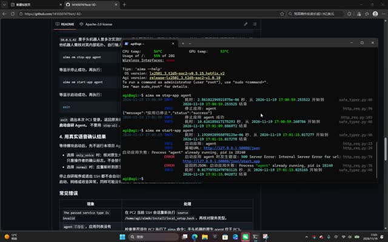
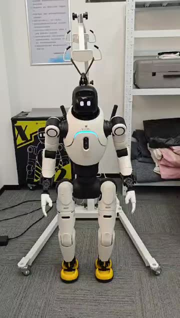

# 灵犀 X2 自研交互 Agent

将仿真中的长者陪护交互迁移到灵犀 X2 真机：AimDK 接入麦克风、扬声器、屏幕表情和预设动作；豆包语音负责 ASR/TTS，`doubao-seed-2-0-mini-260428` 负责回答、上下文及表情/动作选择。食堂意见经用户确认后保存，可在电脑网页查看。

**现在从哪里开始：**已部署的机器人从[日常启动](#每次启动自研交互与查看食堂反馈)开始；新电脑或首次部署先完成[首次部署](#首次部署与更新离线包)。只想恢复机器人自带问答，直接看[恢复原生交互](#恢复原生交互)。

源码主线为 `main`；[v0.3.0第三版标签](docs/zh-CN/releases/v0.3.0.md)保留此前纯语音基线，当前语音、表情、动作联动包含后续main提交，不能用第三版标签代替当前完整效果。版本变化见[CHANGELOG](CHANGELOG.md)和[版本管理](docs/zh-CN/version-management.md)。

## 导航

- [当前验证状态](#当前验证状态)
- [执行窗口与设备](#执行窗口与设备)
- [首次部署与更新离线包](#首次部署与更新离线包)
- [每次启动自研交互与查看食堂反馈](#每次启动自研交互与查看食堂反馈)
- [恢复原生交互](#恢复原生交互)
- [常见问题](#常见问题)
- [演示视频](#演示视频)
- [容器镜像交付](#容器镜像交付)
- [代码与开发文档](#代码与开发文档)

## 当前验证状态

2026-11-19，用户部署回答与动作频率修正版后确认：**“所有效果（语音、表情、动作）都可以了。”** 食堂反馈保存和网页更新也已独立确认。对应实现提交 `a6d88e5`，验收归档 `a6e13fc`；[详细证据](docs/zh-CN/2026-11-19-dialogue-and-gesture-followup.md)。

| 项目 | 已确认范围 |
|---|---|
| 真机环境 | 手头X2 Ultra，AimDK `v1.0.0-ga424add`，Linux aarch64、Python 3.10.12；`only_voice`模式 |
| 语音与对话 | PCM→ASR→Mini→TTS→扬声器跑通，音频焦点申请及释放、连续问答已测 |
| 表情与动作 | 开心/关切表情、右挥手、双手比心曾逐项确认；最新联测用户确认整体效果正常 |
| 自主表现 | 模型同轮选择回答、20种交互表情及29项官方动作/区域组合或null；动作最小间隔8秒，执行前检查稳定站立 |
| 食堂反馈 | 描述→复述→明确确认→JSONL保存→网页查看闭环已测 |
| 本地验证 | 最近相关离线回归229项通过，10轮真实Mini合成文本对照归档 |

尚未逐项验证的27个动作、长时间运行、不同网络/噪声、赛方统一机器人的兼容性及容器真机运行，不能由本轮反馈推定通过。没有新的完整延迟统计，不声称稳定低于2秒。到点主动提醒已排除在开发范围外。

## 执行窗口与设备

| 位置 | 用来做什么 | 如何识别 |
|---|---|---|
| 电脑Windows PowerShell | Git、构建/上传离线包、SSH连接、打开反馈网页 | 提示符以 `PS C:\...>` 开头 |
| 机器人PC2 SSH | 加载AimDK、切换模式、预检、运行自研Agent | 手头机器登录横幅显示SoC1；项目在 `/home/agi/eldercare-x2/eldercare_x2` |
| PC3机内SSH | 重启原生交互agent | 从PC2再SSH进入；手头机器横幅显示SoC2 |

**二开程序在PC2运行，不进入PC1开发，也不修改或重启PC1运控。** PC2与PC3都可能显示 `agi@agi`，只看提示符无法区分。SSH的 `exit` 每次只返回上一层。

Wi-Fi IP每次从机器人信息页核对，不沿用历史地址。`10.0.1.42`是这台机器人已核对的PC3机内地址；其他机器需要重新核对内部拓扑，不能用它替代Wi-Fi地址。

## 首次部署与更新离线包

新电脑或首次部署时完成本节；同一版本日常使用无需重新打包、上传或解压。

### A. 电脑PowerShell：取得当前源码并构建

安装Git及Python 3.10或更新版本，在PowerShell执行：

```powershell
git clone https://github.com/1416507479xzt/-X2-.git
Set-Location .\-X2-
python scripts/build_robot_bundle.py --download-wheels
python -m zipfile -t .\dist\eldercare_x2_aarch64_py310.zip
```

现有仓库在确认本地修改已保存后更新main，再构建即可。构建在电脑上下载锁定的Linux aarch64/Python3.10依赖，机器人无需pip安装；运行云端ASR/LLM/TTS仍需要网络。容器是候选方案，当前实机流程使用ZIP，见[容器说明](docs/zh-CN/docker-reproduction.md)。

### B. 电脑PowerShell：上传并连接PC2

在电脑仓库根目录执行，每行执行完再进行下一行：

```powershell
$RobotIp = (Read-Host '输入机器人当前 Wi-Fi IP').Trim()
if ([string]::IsNullOrWhiteSpace($RobotIp)) { throw '机器人 IP 不能为空' }
ssh "agi@${RobotIp}" 'mkdir -p /home/agi/eldercare-x2'
scp -O .\dist\eldercare_x2_aarch64_py310.zip "agi@${RobotIp}:/home/agi/eldercare-x2/"
ssh -o ServerAliveInterval=15 -o ServerAliveCountMax=3 "agi@${RobotIp}"
```

输入SSH密码时不显示字符是正常的。`scp`完成后仍是Windows窗口；`ssh`登录成功后才进入机器人。

### C. 机器人PC2 SSH：停止旧Agent、解压与预检

如果旧Agent在另一个SSH窗口运行，先在那里按 `Ctrl+C`，不要在它运行时覆盖源码。然后执行：

```bash
cd /home/agi/eldercare-x2
python3 -m zipfile -e eldercare_x2_aarch64_py310.zip .
cd eldercare_x2
source /home/agi/aimdk/install/local_setup.bash
python3 scripts/robot_preflight.py
```

预检通过表示依赖、版本和音频字段符合预期，不表示已测试声音、网络或动作。出现不兼容先记录错误，不修改原生SDK。

### D. 首次配置两把Key（只做一次）

在电脑仓库根目录复制 `.env.example` 为 `.env`，填写自己的 `DOUBAO_SPEECH_API_KEY` 和 `ARK_API_KEY`。两把Key用途不同；已有 `.env` 时不要重新复制模板覆盖它。电脑PowerShell上传：

```powershell
scp -O .\.env "agi@${RobotIp}:/home/agi/eldercare-x2/eldercare_x2/.env"
```

机器人PC2 SSH设置文件权限：

```bash
chmod 600 /home/agi/eldercare-x2/eldercare_x2/.env
```

Key由Agent自动读取，后续不用反复粘贴。现有环境变量优先于文件；不要把 `X2_ONLY_VOICE_CONFIRMED` 写进 `.env`。配置、Key、录音及真实反馈不提交Git或放进离线包。更多逐层探针见[完整部署指南](docs/zh-CN/reproduce-on-x2.md)。

## 每次启动自研交互与查看食堂反馈

按以下顺序连接机器人、切换模式、启动自研交互并查看反馈表。动态地址与日志编号由运行时生成。

### 1. 电脑PowerShell：SSH登录PC2

```powershell
$RobotIp = (Read-Host '输入机器人当前 Wi-Fi IP').Trim()
if ([string]::IsNullOrWhiteSpace($RobotIp)) { throw '机器人 IP 不能为空' }
ssh -o ServerAliveInterval=15 -o ServerAliveCountMax=3 "agi@${RobotIp}"
```

已经在PC2 SSH窗口时跳过。若掉线回到 `PS C:\...>`，先重新连接，不继续输入Linux命令。

<a id="原生交互模块切换重启与恢复"></a>

### 2. PC2 SSH：切换only_voice

先停止旧自研Agent和诊断脚本。若本次已经完成模式设置、原生agent重启和实际行为确认，可直接跳到第5步。新开机或状态不确定时重新核对。

```bash
source /home/agi/aimdk/install/local_setup.bash
ros2 service call /aimdk_5Fmsgs/srv/SetAgentPropertiesRequest aimdk_msgs/srv/SetAgentPropertiesRequest "{contents: {properties: [{key: {value: 2}, value: 'only_voice'}]}}"
```

等服务返回 `response` 再继续。手头机器可返回 `code=0/status.value=0 (UNKNOWN)`，不能单凭此响应宣称切换成功。`only_voice`用于保留自研接入需要的原生语音链路，暂停原生大模型问答；不是把整个原生agent永远关掉。

### 3. PC2进入PC3，逐条重启原生agent

本机已核对的PC3地址：

```bash
ssh agi@10.0.1.42
```

输入密码并核对SoC2横幅后，在PC3执行：

```bash
aima em stop-app agent
```

等停止成功，再执行：

```bash
aima em start-app agent
```

确认启动成功，再执行：

```bash
exit
```

返回PC2。不要把两条aima命令当成PC2命令；不要用 `stop-all` 或修改运控模块。

若启动返回 `500 Server Error` 或 `Process "agent" already running`，先保留输出，通过 `aima em get-app agent` 只读核查PC3应用状态，结合现场行为判断；不将报错视为启动成功，不盲目重复重启或杀进程。

### 4. PC2：确认实际模式

先不启动自研Agent，用原生唤醒词问“现在几点”，确认原生大模型不再回答，并结合原生agent启动结果和已验证的收音链路核对。仅仅没有声音不能证明模式成功。

需要动作时由操作者通过原生控制方式让机器人稳定站立，并留出动作空间。程序不会自动从零力矩切换成站立。

### 5. PC2 SSH：启动自研语音、表情和动作

```bash
cd /home/agi/eldercare-x2/eldercare_x2
source /home/agi/aimdk/install/local_setup.bash
mkdir -p logs
SESSION_ID=$(date +%Y%m%d_%H%M%S)
export DOUBAO_ASR_HOTWORDS='["灵犀"]'
export X2_ONLY_VOICE_CONFIRMED=1
python3 scripts/run_robot_agent.py --transport aimdk --enable-robot-audio --competition-mode --health-semantic model --llm-model doubao-seed-2-0-mini-260428 --presentation-backend aimdk --enable-robot-presentation --enable-robot-motion --vad-idle-seconds 1.5 --aimdk-streaming-asr --dining-feedback-records data/dining_feedback.jsonl --log-file "logs/autonomy_${SESSION_ID}.log" --metrics-file "logs/autonomy_${SESSION_ID}_metrics.json"
```

保持这个窗口运行，等预检通过并显示等待唤醒/会话就绪，再说“你好灵犀”，等它询问状态后回答。终端会显示ASR、模型回答、TTS及表现服务日志；声音和物理动作是否完成需现场观察。

| 参数/命令 | 用途 |
|---|---|
| `source ...local_setup.bash` | 为当前SSH会话加载AimDK；新开会话要重新加载 |
| `X2_ONLY_VOICE_CONFIRMED=1` | 人工确认标志；不会替你切模式 |
| `--presentation-backend aimdk`与两个enable开关 | 启用真机表情及动作；模型从目录选一项或null |
| `--vad-idle-seconds 1.5` | 收音停止但缺END时的有界片段收尾 |
| `--aimdk-streaming-asr` | 收音期间开始连接和上传ASR |
| `--dining-feedback-records` | 反馈保存位置，与下面网页入口一致 |
| `mkdir -p logs`、`SESSION_ID`、两个日志参数 | 目录已存在时复用，每次运行生成独立日志与耗时文件 |

日志落在机器人项目 `logs/` 内，不是录音文件。开发测试建议保留；若只需日常演示，可从启动命令删去 `--log-file`、`--metrics-file`及各自紧随的路径，终端仍显示信息，食堂保存不受影响。

### 6. 电脑另开PowerShell：打开食堂反馈表

不要关闭运行Agent的SSH窗口，也不要在机器人终端输入Windows路径。电脑仓库根目录执行：

```powershell
.\open_dining_dashboard.cmd
```

也可从任意PowerShell目录使用本机完整路径：

```powershell
& 'C:\Users\LENOVO\Desktop\2026浙江省数智【具身智能应用实践赛道】文件\智慧养老\智慧养老_参赛源码\open_dining_dashboard.cmd'
```

其他电脑使用实际克隆目录。按提示输入当前Wi-Fi IP，并在新SSH窗口自行输入密码，连通后浏览器自动打开。默认从本地18765–18775中选择可用端口，例如 `http://127.0.0.1:18765/`；以脚本实际打印的地址为准，保留网页SSH连接窗口。

**网页只负责查看，Agent负责保存。** 对机器人说食堂意见，等复述后明确确认，Agent才写入机器人上的 `data/dining_feedback.jsonl`。不开网页、关闭网页都不影响运行中的Agent保存；以后打开网页可查看历史记录。网页的 `new` 是记录状态，不代表已实际提交给食堂工作人员。

### 7. 测试与停止

观察语音是否完整、表情是否可见、动作是否完整收回且站立稳定。可依次测试“今天感觉不错”“今天有什么注意事项”，以及挥手、间隔至少8秒后双手比心；再完成一条食堂反馈确认并核对网页。

结束时在Agent窗口按 `Ctrl+C`，退出后执行：

```bash
unset X2_ONLY_VOICE_CONFIRMED DOUBAO_ASR_HOTWORDS
```

它只清理当前终端的临时标志，不删除 `.env`、日志和反馈，也不恢复原生问答。关闭反馈网页的SSH窗口只结束查看服务；恢复原生问答按下一节执行。

## 恢复原生交互

先在自研Agent窗口按 `Ctrl+C`，确认停止。PC2 SSH执行：

```bash
source /home/agi/aimdk/install/local_setup.bash
ros2 service call /aimdk_5Fmsgs/srv/SetAgentPropertiesRequest aimdk_msgs/srv/SetAgentPropertiesRequest "{contents: {properties: [{key: {value: 2}, value: 'normal'}]}}"
```

等返回响应，仍在PC2执行：

```bash
ssh agi@10.0.1.42
```

进入已核对的PC3后，逐条执行、每步确认成功再继续：

```bash
aima em stop-app agent
```

```bash
aima em start-app agent
```

```bash
exit
```

返回PC2后，不运行自研Agent，说原生唤醒词并问“现在几点”，实际听到原生回答才算恢复。停止脚本、清理变量或退出SSH都不会自动恢复normal。出现报错先停在该步骤排查，不将服务请求返回等同于模式生效。

## 常见问题

| 现象 | 先检查什么 |
|---|---|
| Windows提示source、python3或Linux路径不存在 | SSH是否断开了？先重新登录PC2 |
| Python找不到 `/home/agi/scripts/...` | 是否漏了 `cd /home/agi/eldercare-x2/eldercare_x2` |
| `The passed service type is invalid` | 在PC2重新source AimDK，再核对接口 |
| aima列表里没有agent | 是否在PC2执行？手头机器原生agent在PC3 |
| `already running / 500` | 保留输出并核查PC3实际应用状态；不视为成功，不盲目重启或杀进程 |
| 没表情或动作 | 是否开启对应参数？检查表现回执、冷却、控制权、站立；accepted不等于已完成 |
| 网页打不开 | 是否在电脑运行入口、完成密码输入并保留SSH窗口？使用脚本打印的本地URL |
| 网页没有新记录 | Agent是否运行、意见是否明确确认、Agent与网页是否读取同一JSONL路径 |

## 演示视频

2026-11-19现场演示，分别记录电脑屏幕操作与机器人实机。点击预览图或下方链接进入视频文件页面播放；如果浏览器未显示播放器，可使用文件页面的下载入口观看。两段视频分别展示现场过程，不作为全部功能或全部动作验收证明。

| 电脑屏幕录制（约4分45秒） | 机器人实机（约2分51秒） |
|---|---|
| [](docs/media/x2-desktop-demo.mp4) | [](docs/media/x2-robot-demo.mp4) |
| [播放／下载电脑屏幕视频](docs/media/x2-desktop-demo.mp4) | [播放／下载机器人实机视频](docs/media/x2-robot-demo.mp4) |

电脑录屏为适合仓库分发的H.264压缩副本，保留原分辨率、完整时长和声音；实机视频保留原文件。开发电脑上的两份原视频没有修改。视频仅用于项目展示，不包含在机器人运行所需的离线部署包中。


## 容器镜像交付

当前全部应用运行代码已纳入ARM64镜像构建，完整入口覆盖语音、表情、动作与食堂反馈。后续运行源码或依赖更新自动构建新镜像，并以Git提交号标记、校验源码一致性；旧镜像不会自行包含未来优化。Actions提供可复制导入的镜像及启动交付包，成功发布的GHCR镜像支持提交号回滚。

在官方允许的PC2容器环境中，交付目录运行 `bash run.sh load`、`bash run.sh preflight`；确认only_voice和稳定站立后运行 `X2_ONLY_VOICE_CONFIRMED=1 bash run.sh full-agent`。电脑查看网页使用 `open_container_feedback.cmd`，与ZIP部署的入口分开。Key、SDK/固件及DDS配置仍由目标设备提供。

2026-11-20完整ARM64镜像已构建并发布，234项云端离线回归及源码摘要校验通过，离线交付附件已生成。[本次镜像、digest与下载记录](docs/zh-CN/2026-11-20-full-container-build.md)。

**容器真机验收尚未完成，当前不要替换已验证的ZIP部署。** 官方路径使用Podman，适用范围与机载版本需要核对。[镜像交付和验证步骤](docs/zh-CN/docker-reproduction.md)、[随包操作指南](docker/CONTAINER-QUICKSTART.md)。

## 代码与开发文档

| 主题 | 入口 |
|---|---|
| 首次部署、接口探针与兼容性 | [复现指南（v0.3.0语音基线）](docs/zh-CN/reproduce-on-x2.md)、[现场部署选择](docs/zh-CN/onsite-deployment.md)；当前完整联动按本README |
| 29项动作及表情 | [自主表现目录](docs/zh-CN/autonomous-presentation.md)、[11月19日联调](docs/zh-CN/2026-11-19-presentation-integration.md) |
| 食堂意见与网页 | [食堂反馈步骤](docs/zh-CN/stage4-dining-feedback.md) |
| 语音对照与历史问题 | [语音验收](docs/zh-CN/voice-dialogue-acceptance.md)、[ASR诊断](docs/zh-CN/2026-11-18-x2-asr-diagnosis.md)、[播音与保存路径](docs/zh-CN/2026-11-18-playback-and-feedback-path.md) |
| 模型比较与版本 | [四模型记录](docs/zh-CN/model-evaluation/2026-11-08/赛事评分对比.md)、[版本管理](docs/zh-CN/version-management.md)、[CHANGELOG](CHANGELOG.md) |
| Docker候选 | [构建记录](docs/zh-CN/2026-11-18-container-build.md)、[容器复现](docs/zh-CN/docker-reproduction.md)，尚未真机验收 |
| 主要代码 | `x2_agent/agent.py` 会话；`model_dialogue.py` 模型规划；`aimdk_*` 真机音频；`presentation.py` 表情动作；`dining_feedback.py` 保存；`scripts/run_robot_agent.py` 启动 |

仿真回归：准备Unity便携模拟器及依赖、私有 `.env` 后，在电脑仓库根目录执行 `python agent.py --competition-mode --health-semantic model`，详见[中文开发指南](docs/zh-CN/README.md)。本README的真机入口使用AimDK，不使用Unity连接。

`.gitignore` 排除私有配置、运行日志、录音、真实JSONL和生成ZIP。药品资料与提醒为演示配置，不能代替个人医嘱或真实预约。开源来源见[开源引用说明](开源引用说明.md)。
